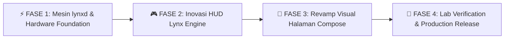

# 🗺️ Lynx V7 - Deity Master Engineering Roadmap & Next-Gen Milestones
> **Target Release Line**: Lynx V7 Generation (`7.0.0-RC252+` Uncapped RC Cycle)  
> **Repository**: [Zy0x/Lynx](https://github.com/Zy0x/Lynx)  
> **Primary Interfaces**: Native Android Companion App (`LynxCompanion` / Jetpack Compose) & Native Rust Kernel Daemon (`lynxd`)  
> **Hardware Architectures**: Hybrid Qualcomm Snapdragon & MediaTek (Helio / Dimensity) with Generic Linux Fallback  

---

## 📌 Ringkasan Eksekutif & Visi Pengembangan

Dokumen ini merupakan **Cetak Biru Teknik Resmi (Master Engineering Roadmap)** untuk rilis kenaikan versi berikutnya dari **Lynx V7 - Deity**. Seluruh rencana kerja di bawah ini dirancang secara terperinci, komprehensif, dan siap dieksekusi secara berurutan sesuai prinsip arsitektur *Native-First*, *Hardware Ground Truth*, dan *Safety First*.

Roadmap ini disinkronkan secara langsung dengan **Pull Request di GitHub** sebagai *Living Master Work Board*. Setiap sub-tugas dan sub-sub bagian dilengkapi dengan kotak centang (*interactive checklist*) yang akan diperbarui secara kontinu seiring diselesaikannya implementasi kode.

---

## 🏗️ 4 Fase Rekayasa Terstruktur (Phased Engineering Breakdown)

---

## ⚡ FASE 1: Mesin Native Rust `lynxd` & Hardware Foundation

Fase ini berfokus pada penguatan fondasi sistem di lapisan kernel dan daemon native (`native/lynxd/`), menyatukan kontrol pengisian daya universal, bypass charging, optimasi latensi jaringan Wi-Fi, serta penyetelan performa CPU & GPU terpadu.

### 1.1 Universal CPU & EAS Scheduler Engine (`native/lynxd/src/subsystems/cpu.rs`)
- [ ] **Penyempurnaan Pelindung Penjadwal Otonom (*Scheduler Guardian v2*)**
  - [ ] Implementasi penguncian izin atomik (`0644`/`0444`) untuk `/dev/stune/top-app/schedtune.boost` dan `/dev/stune/top-app/schedtune.prefer_idle` di seluruh profil performa.
  - [ ] Pemantauan sub-siklus (*watchdog loop*) setiap 500ms saat layar menyala untuk memulihkan margin boost yang dibatalkan oleh `system_server` atau OEM power HAL.
  - [ ] Penambahan dukungan *Energy Aware Scheduling (EAS)* untuk kluster CPU Tri-Cluster (Prime + Gold + Silver / Cortex-X + Cortex-A7xx + Cortex-A5xx).
  - [ ] Pengikatan afinitas thread game render (*Core Affinity Packing*) ke kluster performa secara dinamis tanpa mengorbankan thread audio.
- [ ] **Penyetelan Governor CPUFreq Dinamis**
  - [ ] Integrasi governor `schedutil` dengan parameter adaptif: `up_rate_limit_us` (500us saat game) dan `down_rate_limit_us` (4000us untuk stabilitas frekuensi).
  - [ ] MediaTek PPM (Power Policy Manager) deep control: override `/proc/ppm/policy/userlimit_cpu_core` dan `policy_status`.
  - [ ] Fallback profil hemat daya otomatis saat suhu baterai menyentuh batas kritis (>46°C).

### 1.2 Universal GPU & Graphics Compositor Engine (`native/lynxd/src/subsystems/gpu.rs`)
- [ ] **Subsystem Khusus Qualcomm Adreno (KGSL)**
  - [ ] Kontrol devfreq bus clock override pada `/sys/class/kgsl/kgsl-3d0/devfreq/min_freq` dan `max_freq`.
  - [ ] Penyetelan parameter latensi bus KGSL (`bus_split`, `force_bus_on`, `force_rail_on`, `force_clk_on`) untuk eliminasi micro-stuttering.
  - [ ] Adreno GPU governor optimizer: transisi mulus antara `msm-adreno-tz` dan `performance`.
  - [ ] Prapemanasan cache shader (*Shader Cache Pre-warming*) via penulisan properti `debug.hwui.use_gpu_pixel_buffers = true`.
- [ ] **Subsystem Khusus MediaTek Mali (GED / FPSGO)**
  - [ ] Akselerasi MediaTek GED driver via `/proc/ged/hal/custom_upbound_gpu_freq` dan `/proc/ged/hal/custom_boost_gpu_freq`.
  - [ ] Penyetelan MTK FPSGO: override target frame rate dan boost threshold (`/sys/module/mtk_fpsgo/parameters/`).
  - [ ] ARM Mali Kbase scheduling priority boost via sysfs `/sys/devices/platform/13040000.mali/dvfs_enable`.
- [ ] **Generic Linux Devfreq Driver Fallback**
  - [ ] Pendeteksian node devfreq universal `/sys/class/devfreq/` jika GPU vendor khusus tidak teridentifikasi.
  - [ ] Verifikasi izin tulis transaksi (*Transaction Write Verification*) sebelum menerapkan clock GPU.

### 1.3 Pengisian Daya Cepat Universal (MediaTek PumpExpress & Multi-OEM Fast Charging)
- [ ] **Arsitektur Pengontrol Arus Terpadu (`native/lynxd/src/hardware/charging.rs`)**
  - [ ] Deteksi otomatis protokol pengisian daya: MediaTek PumpExpress (PE+ 1.0/2.0/3.0/4.0), Qualcomm Quick Charge (QC 3.0/4.0/5.0), USB Power Delivery (USB-PD PPS), dan OEM Proprietary (Transsion Ultra Charge, Xiaomi HyperCharge, VOOC/Dart/Warp).
  - [ ] Penyelaman node sysfs arus baterai universal:
    - [ ] `/sys/class/power_supply/battery/current_max`
    - [ ] `/sys/class/power_supply/battery/constant_charge_current_max`
    - [ ] `/sys/class/power_supply/main/current_max`
    - [ ] `/sys/class/power_supply/usb/current_max`
    - [ ] `/sys/devices/platform/charger/charging_current`
    - [ ] `/sys/class/power_supply/battery/step_charging_enabled`
  - [ ] Preset arus bertingkat aman:
    - [ ] *Standard Safe*: 1500mA – 2000mA (Temperatur rendah, menjaga usia sel baterai).
    - [ ] *Turbo Fast*: 2500mA – 3300mA (Pengisian cepat harian teroptimasi).
    - [ ] *Extreme Unrestricted*: Hingga 4500mA+ (Batas penuh OEM jika kabel & adaptor mendukung, dengan disclaimer pendingin eksternal).
- [ ] **Manajemen Termal Pengisian Daya Pintar (*Thermal-Aware Step Charging*)**
  - [ ] Pemantauan suhu sel baterai setiap 2 detik saat terhubung ke charger.
  - [ ] Kurva penyesuaian arus dinamis:
    - [ ] Suhu < 38°C: Arus penuh sesuai preset aktif.
    - [ ] Suhu 38°C – 42°C: Penurunan bertahap 15% untuk mencegah lonjakan panas.
    - [ ] Suhu 42°C – 45°C: Pembatasan ke 1500mA (Mode aman OEM).
    - [ ] Suhu > 45°C: Proteksi darurat, pembatasan ke 1000mA hingga suhu turun di bawah 40°C.

### 1.4 Bypass Charging (Penyuplai Daya Langsung Motherboard)
- [ ] **Mesin Penonaktifan Pengisian Sel Baterai (*Battery Charge Suspend*)**
  - [ ] Deteksi dan penguncian node hardware bypass universal:
    - [ ] `/sys/class/power_supply/battery/charging_enabled` -> `0`
    - [ ] `/sys/class/power_supply/battery/battery_charging_enabled` -> `0`
    - [ ] `/sys/class/power_supply/battery/input_suspend` -> `1`
    - [ ] `/sys/class/power_supply/battery/charge_control_limit_max` -> `0`
    - [ ] `/sys/class/power_supply/battery/store_mode` -> `1` (Mode pameran/toko Sony/Samsung/Infinix)
    - [ ] `/sys/class/power_supply/main/charging_enabled` -> `0`
  - [ ] Verifikasi status hardware: Arus baterai wajib bernilai `0 mA` atau mendekati netral (`±50 mA`) saat charger tetap terpasang memasok daya motherboard.
- [ ] **Modul Tambal Kernel KPM (*Kernel Patch Module*) Fallback**
  - [ ] Penyempurnaan biner KPM `native/kpm/lynx_bypass_charge/lynx_bypass_charge.c` untuk kernel OEM yang mengunci node sysfs baterai pada level driver Linux.
  - [ ] Auto-hook pada fungsi kernel `power_supply_set_property` dan `charger_manager`.
- [ ] **Pemicu Otomatis Cerdas Saat Bermain Game (*Smart In-Game Auto-Bypass*)**
  - [ ] Deteksi otomatis ketika game berat (Genshin Impact, HSR, WuWa, PUBG, MLBB) aktif di layar depan DAN charger terpasang.
  - [ ] Jika persentase baterai telah mencapai ambang batas aman pengguna (misal: >= 80%), mesin secara otonom mengaktifkan Bypass Charging.
  - [ ] Pemulihan pengisian normal seketika saat game ditutup atau pengguna mencabut charger.

### 1.5 Wi-Fi & Jaringan Gaming Rendah Latensi (Low-Latency Network Engine)
- [ ] **Penyetelan Driver Wi-Fi Chipset (Qualcomm & MediaTek)**
  - [ ] Penonaktifan mode hemat daya Wi-Fi (*Wi-Fi Power Save Mode / PSM*) saat game aktif untuk mencegah lonjakan jitter paket.
  - [ ] Penyetelan WCNSS bonding pada Qualcomm (`platforms/qcom/system/vendor/firmware/wlan/`).
  - [ ] Optimasi MediaTek Wi-Fi driver cfg (`/vendor/firmware/wifi.cfg` dan node `/proc/net/wlan/`).
- [ ] **Optimasi Tumpukan Protokol Jaringan Kernel (*Kernel TCP/IP Stack*)**
  - [ ] Pengaktifan algoritma *TCP BBR (Bottleneck Bandwidth and RTT)* atau *Westwood* untuk meminimalkan *packet loss* pada koneksi nirkabel.
  - [ ] Penskalaan buffer socket TCP gaming:
    - [ ] `net.core.rmem_max = 8388608` (8 MB buffer terima)
    - [ ] `net.core.wmem_max = 8388608` (8 MB buffer kirim)
    - [ ] `net.ipv4.tcp_rmem = 4096 87380 8388608`
    - [ ] `net.ipv4.tcp_wmem = 4096 65536 8388608`
  - [ ] Penyetelan antrean paket *FQ-CoDel (Fair Queueing Controlled Delay)* untuk mencegah *bufferbloat*.
  - [ ] Penyetelan ARP cache timeout dan penonaktifan *TCP Slow Start Pasca-Idle*.

### 1.6 Memori Virtual & Penyangga Anti-Allocstall
- [ ] **Penyetelan Kompresi ZRAM / ZSWAP Tingkat Lanjut**
  - [ ] Penggunaan algoritma kompresi berkecepatan tinggi `lz4` atau `zstd` dengan alokator `zsmalloc`.
  - [ ] Penskalaan disk ZRAM dinamis (50%–75% dari RAM fisik) dengan prioritas swap `32767`.
- [ ] **Pencegahan Latensi Alokasi Memori (*Anti-Allocstall Guard*)**
  - [ ] Mempertahankan penyangga `extra_free_kbytes = 65536` (64 MB) dan `watermark_scale_factor = 150` pada profil performa.
  - [ ] Penyetelan `vfs_cache_pressure = 50` untuk menjaga inode dunia terbuka tetap di-cache dalam RAM.
  - [ ] Penekanan pemadatan halaman memori sinkron (*direct compaction suppression*) saat render thread game aktif.

---

## 🎮 FASE 2: Inovasi HUD Lynx Engine & Floating Overlay

Fase ini memfokuskan pengembangan pada antarmuka *in-game* mengambang (*Freeform Floating HUD*), menghadirkan kontrol cepat satu sentuhan, telemetri real-time, ergonomi handle bilah sisi, serta perluasan kecerdasan Vision AI Auto-Skip ke berbagai game RPG populer.

### 2.1 Ergonomi Handle Bilah Sisi (*Sidebar Handle & Touch Ergonomics*)
- [ ] **Memori Posisi Spasial Dua Arah (Landscape & Portrait Separation)**
  - [ ] Penyimpanan koordinat sumbu Y handle yang terpisah secara independen untuk orientasi Lanskap dan Potret pada `HudPreferences.kt`.
  - [ ] Restorasi posisi handle instan tanpa efek *snap back* atau *jump* saat bilah sisi ditutup kembali oleh pengguna.
  - [ ] Batasan margin aman layar (*Safe-area padding bounds clamp*) agar handle tidak tertutup lubang kamera (*punch hole*) atau navigasi gestur sistem.
- [ ] **Desain Visual & Interaksi Sentuhan Handle**
  - [ ] Visual kapsul bilah sisi Cyberpunk OLED transparan dengan garis aksen Cyan yang elegan.
  - [ ] Efek haptik mikro (*tactile vibration feedback*) saat handle disentuh, digeser, atau dilepas.
  - [ ] Pengaturan tingkat transparansi (*opacity dial*) saat handle dalam kondisi diam (*idle state*).

### 2.2 Dashboard Telemetri Mengambang (*Floating Live Telemetry Cards*)
- [ ] **Pengukur Latensi & Frame Rate Real-Time**
  - [ ] Analisis frame rate instan via SurfaceFlinger pipe parser (<1% CPU overhead).
  - [ ] Grafik sparkline riwayat FPS dengan deteksi micro-stuttering visual.
- [ ] **Monitor Beban Hardware & Suhu Multi-Sensor**
  - [ ] Tampilan persentase beban CPU per kluster (LITTLE / MID / BIG) dengan indikator frekuensi MHz aktif.
  - [ ] Monitor utilisasi GPU (%) dan frekuensi clock aktif.
  - [ ] Suhu SoC nyata (*die temperature*), suhu baterai, serta laju arus pengisian/pengurasan daya nyata dalam satuan miliampere (mA).

### 2.3 Kontrol Cepat Dalam Game (*In-Game Quick Action Toggles*)
- [ ] **1-Tap Profile Switcher Cepat**
  - [ ] Tombol pintas melingkar untuk beralih mode profil instan: *Balanced* <-> *Performance* <-> *Extreme* tanpa keluar dari game.
- [ ] **1-Tap Bypass Charging Toggle**
  - [ ] Sakelar cepat aktivasi Bypass Charging langsung dari jendela mengambang saat bermain sambil mengisi daya.
- [ ] **1-Tap Network Gaming Latency Booster**
  - [ ] Tombol purifikasi paket Wi-Fi dan reset buffer TCP gaming sekali sentuh.
- [ ] **1-Tap RAM Purge & Cache Cleaner**
  - [ ] Pembersihan aman memori latar belakang tanpa mematikan proses game aktif di layar depan.

### 2.4 Ekspansi Mesin Cerdas Vision AI Auto-Skip Multi-Game
- [ ] **Penyempurnaan Arsitektur Triple-Shield Vision AI**
  - [ ] Penguatan deteksi glif tombol dialog beruntun (`maxRun >= 3` piksel bersebelahan) dan ambang batas dinamis 18px pada 1080p.
  - [ ] Evaluasi margin hitam 80% pada baris prompt untuk membedakan adegan narasi vs gameplay gelap di dalam gua.
- [ ] **Ekspansi Basis Data Game Hoyoverse & RPG Baru**
  - [ ] Dukungan modul auto-skip untuk **Honkai: Star Rail** (dialog cerita dan transisi dialog pilihan).
  - [ ] Dukungan modul auto-skip untuk **Zenless Zone Zero** (dialog komik dan percakapan kota).
  - [ ] Dukungan modul auto-skip untuk **Wuthering Waves** (dialog NPC dan cutscene narasi).
- [ ] **Antarmuka Kalibrasi Citra Mandiri di Aplikasi Companion (*Vision AI Calibration GUI*)**
  - [ ] Layar pratinjau koordinat pemindaian langsung di atas tangkapan layar game.
  - [ ] Slider visual interaktif untuk mengatur toleransi warna dan batas irisan tanpa edit skrip manual.

---

## 🎨 FASE 3: Revamp Visual Total Per-Halaman Compose (`LynxCompanion`)

Fase ini merevolusi seluruh halaman antarmuka pengguna pada aplikasi Native Android (`LynxCompanion` / Jetpack Compose), mengimplementasikan desain Cyberpunk OLED Dark yang konsisten, komponen Bento Grid modern, animasi halus berkecepatan 60/120 FPS, dan target sentuh ergonomis >= 48dp.

### 3.1 Standardisasi Sistem Desain & Token Visual Cyberpunk OLED
- [ ] **Palet Warna & Token Kontras Tinggi**
  - [ ] Latar belakang hitam murni OLED (`#050505` dan `#0A0A0A`) untuk efisiensi daya layar AMOLED.
  - [ ] Kartu kontras bergradasi lembut (`#121212` s/d `#181818`) dengan batas halus 1dp (`#262626`).
  - [ ] Warna aksen semantik: *Neon Cyan* (`#00FFAA`) untuk status aktif/efisien, *Electric Blue* (`#0099FF`) untuk navigasi utama, *Amber Gold* (`#FFB800`) untuk peringatan/bypass, dan *Crimson Red* (`#FF3366`) untuk mode ekstrem.
- [ ] **Ergonomi Sentuhan & Tipografi Semantik**
  - [ ] Seluruh target interaktif (tombol, sakelar, slider) memiliki ukuran sentuh minimal **48×48 dp** tanpa risiko *miss-touch*.
  - [ ] Tata letak stabil dan presisi pada seluruh rasio layar non-reguler (1080×2400, 1080×2460, 20:9, 20.5:9, 21:9) hingga tablet.
  - [ ] Transisi mikro-animasi Compose responsif dengan durasi **150–250 ms** yang ringan tanpa memicu lonjakan Garbage Collection (GC).

### 3.2 Revamp Visual Halaman Tab 0 (Dashboard & Sistem Overview)
- [ ] **Kartu Hero Status Sistem (*System Identity Hero Card*)**
  - [ ] Lencana arsitektur chipset dinamis beranimasi halus: *Qualcomm Snapdragon* vs *MediaTek Helio/Dimensity*.
  - [ ] Tampilan status daemon native `lynxd` (PID, uptime, memori residen, arsitektur AArch64).
  - [ ] Indikator status root universal (KernelSU / APatch / Magisk) dengan verifikasi izin eksekusi.
- [ ] **Pengukur Metrik Hardware Real-Time (*Live Gauge Bento Tiles*)**
  - [ ] Cincin progres melingkar interaktif untuk utilisasi CPU, frekuensi GPU, dan pemakaian RAM.
  - [ ] Kartu status baterai: persentase, voltase (mV), suhu (°C), dan indikator status pengisian/bypass aktif.
- [ ] **Pemilih Profil Utama 1-Sentuh (*Master Profile Carousel Card*)**
  - [ ] Kartu Bento pilihan 4 profil: *Powersave*, *Balanced*, *Performance*, *Extreme Unrestricted*.
  - [ ] Aksen visual dinamis yang berubah warna sesuai profil aktif dengan konfirmasi instan.

### 3.3 Revamp Visual Halaman Tab 1 (Tuning Hub & Kontrol Hardware)
- [ ] **Kategori Tuning CPU (*CpuMasterTunerCard*)**
  - [ ] Pemilih frekuensi minimum dan maksimum per-kluster CPU (LITTLE / MID / BIG) dengan slider presisi.
  - [ ] Sakelar penguncian frekuensi (*Core Clock Lock*) dengan konfirmasi batas keamanan.
- [ ] **Kategori Tuning GPU (*GpuMasterTunerCard & AdaptiveGpuHardwareCard*)**
  - [ ] Pemilih OPP clock GPU fisik (MHz picker) dengan grafik beban real-time kurva Bezier.
  - [ ] Pengaturan eksklusif driver sysfs GPU (Adreno KGSL bus split vs MediaTek GED boost).
- [ ] **Kategori Baterai & Pengisian Daya (*TuningChargingCategory*)**
  - [ ] Kartu kendali Pengisian Cepat Universal: slider pilihan batas arus (1000mA s/d 4500mA+).
  - [ ] Sakelar Bypass Charging mandiri dengan kartu status pengiriman daya motherboard secara langsung.
  - [ ] Dialog batas arus kustom (*CustomCurrentLimitDialog*) dengan validasi rentang hardware.
- [ ] **Kategori Layar, Refresh Rate & Sentuhan (*DisplayRefreshRateTouchCard*)**
  - [ ] Sakelar physical mode HWC SurfaceFlinger (60Hz / 90Hz / 120Hz / 144Hz).
  - [ ] Multi-OEM TouchBoost optimizer dan DC Dimming hardware toggle.
- [ ] **Kategori Jaringan & Wi-Fi (*NetworkLatencyTunerCard*)**
  - [ ] Sakelar Wi-Fi Gaming Low Latency dan pemilihan algoritma TCP Congestion Control (BBR / Cubic).

### 3.4 Revamp Visual Halaman Tab 2 (Telemetri Hardware & Spesifikasi Murni)
- [ ] **Status Murni Read-Only (Domain Isolation Tab 2)**
  - [ ] Menegakkan isolasi domain: Tab 2 murni berstatus Read-Only tanpa tombol interaktif pengubah kernel.
  - [ ] Tabel spesifikasi mendalam: Detail node DTB kernel, GPU renderer string, Vulkan API version, OpenCL extensions.
  - [ ] Matriks sensor termal lengkap: CPU clusters, GPU, battery, charger IC, skin temperature.
  - [ ] Diagnostik storage I/O: UFS / eMMC health status, throughput baca/tulis IOPS.

### 3.5 Revamp Visual Halaman Tab 3 (Profil Per-Aplikasi & Lab Eksperimental)
- [ ] **Hub Pengaturan Per-Aplikasi (*Per-App Graphics & Profile Hub*)**
  - [ ] Daftar aplikasi dan game terpasang dengan filter pencarian instan.
  - [ ] Penetapan profil performa otomatis per-aplikasi (misal: YouTube -> Powersave, Genshin -> Extreme).
  - [ ] Penetapan refresh rate layar dinamis per-paket aplikasi.
- [ ] **Laboratorium Pengujian Baterai (*BatteryLabSubscreen*)**
  - [ ] Simulator pengurasan daya dan pemantauan degradasi kapasitas baterai nyata (mAh).
  - [ ] Riwayat pengisian daya dengan grafik gelombang sparkline waktu nyata.
- [ ] **Penjadwal Otomasi Harian (*Cron Schedule Manager*)**
  - [ ] Konfigurasi jadwal pembersihan cache berkala dan pemulihan profil harian.

### 3.6 Revamp Halaman Pengaturan, OTA & Manajemen Modul
- [ ] **Pengelola Pembaruan OTA Terintegrasi (*In-App OTA Updater*)**
  - [ ] Pengecekan versi rilis baru langsung ke API GitHub Releases.
  - [ ] Tampilan catatan rilis (*Changelog Viewer*) dengan format Markdown interaktif di dalam aplikasi.
  - [ ] Pengunduhan paket ZIP modul dan file APK dengan verifikasi checksum SHA-256.
- [ ] **Pusat Pencadangan & Restorasi Konfigurasi (*Backup & Restore*)**
  - [ ] Ekspor dan impor seluruh setelan ke berkas `lynx_config.json`.
  - [ ] Tombol reset ke setelan pabrik (*Factory Reset Safemode*) dengan konfirmasi ganda.

---

## 🧪 FASE 4: Pengujian Lab Hardware Fisik, Safety Fallback & Rilis Produksi

Fase ini menjamin seluruh fitur yang dibangun diuji secara ketat pada perangkat keras nyata (MediaTek & Qualcomm), bebas dari risiko bootloop, stabil pada penggunaan gaming jangka panjang, dan siap dirilis ke publik.

### 4.1 Matriks Perangkat Uji Fisik (*Ground Truth Hardware Staging*)
- [ ] **Pengujian MediaTek (Perangkat Utama: Infinix Note 11 Pro / X698 - Helio G96, Mali-G57 MC2, 2460×1080)**
  - [ ] Uji coba deteksi SoC anti-spoofing via driver kernel DTB dan node GPU `/dev/mali0` / `/dev/ged`.
  - [ ] Verifikasi MediaTek PumpExpress fast charging dan bypass charging pada controller charger Transsion.
  - [ ] Uji stabilitas frame rate Genshin Impact 60 FPS pada profil *Performance* dan *Extreme*.
- [ ] **Pengujian Qualcomm (Perangkat Sekunder: Redmi Note 7 - SDM660, Adreno 512, 2340×1080)**
  - [ ] Uji coba deteksi node hardware Adreno `/dev/kgsl-3d0` dan sysfs devfreq bus boost.
  - [ ] Verifikasi Qualcomm Quick Charge dan USB-PD step charging.
- [ ] **Pengujian Fallback Generic Linux**
  - [ ] Uji coba fungsionalitas aman pada perangkat non-QCOM/non-MTK tanpa crash atau bootloop.

### 4.2 Uji Stres Termal & Daya Tahan Baterai (*Thermal & Endurance Stress Trials*)
- [ ] **Uji Stres Gaming 60 Menit (Genshin Impact / Wuthering Waves)**
  - [ ] Pengukuran kestabilan frekuensi clock CPU/GPU tanpa thermal throttling prematur.
  - [ ] Pengujian suhu sel baterai: Verifikasi penurunan arus pengisian daya otomatis saat menyentuh 42°C.
- [ ] **Uji Ketahanan Bypass Charging 3 Jam**
  - [ ] Verifikasi persentase baterai tetap konstan (delta = 0%) selama sesi gaming 3 jam penuh dengan charger terpasang.
  - [ ] Pengecekan suhu baterai: Verifikasi suhu baterai lebih dingin minimal 4°C–6°C dibanding mode pengisian standar.

### 4.3 Protokol Keselamatan & Mitigasi Bootloop (*Safety Failsafe Protocols*)
- [ ] **Mekanisme Darurat Tombol Volume (*Emergency Hardware Disarm*)**
  - [ ] Penekanan tombol `Volume Down` saat cold-boot secara otomatis menonaktifkan modul dan mereset profil ke mode *Safe Balanced*.
- [ ] **Status Aman Boot Pertama (*Dormant First-Boot Protocol*)**
  - [ ] Modul diinstal dalam status `"active_profile": "dormant"`, dilarang menerapkan clock ekstrem sebelum dibuka oleh pengguna.
- [ ] **Verifikasi Pembersihan Total Saat Uninstall (`uninstall.sh`)**
  - [ ] Pemulihan 100% parameter global sistem Android, sysfs kernel, dan properti vendor ke kondisi pabrik saat modul dihapus.

### 4.4 Otomasi Rilis & Pemaketan Produksi
- [ ] **Pemeriksaan Standar Kode & Batas Berkas**
  - [ ] Seluruh berkas Kotlin berada di bawah batas ketat 699 baris kode.
  - [ ] Kompilasi biner Native Rust `lynxd` berstatus release ter-strip dengan LTO (*Link-Time Optimization*).
- [ ] **Pemaketan Rilis Terpadu (Dual-Artifact Release Pipeline)**
  - [ ] Pembangunan berkas APK Rilis minifikasi R8 (`LynxKernelManager.apk`).
  - [ ] Pembangunan berkas ZIP modul Magisk/KernelSU/APatch universal.
  - [ ] Pembaruan berkas riwayat rilis resmi di `changelog.md` dan metadata `module.prop`.

---

## 📊 Matriks Progres & Status Pelacakan

| Fase Rekayasa | Fokus Domain | Jumlah Sub-Tugas | Status Eksekusi |
| :--- | :--- | :--- | :--- |
| **Fase 1** | Mesin Native Rust `lynxd`, Fast Charging, Bypass & Wi-Fi | 32 Sub-Tugas | 🟡 *Dalam Perencanaan / Siap Eksekusi* |
| **Fase 2** | Inovasi HUD Lynx Engine & Multi-Game Vision AI | 22 Sub-Tugas | 🟡 *Dalam Perencanaan / Siap Eksekusi* |
| **Fase 3** | Revamp Visual Total Halaman Compose (Tab 0–3 & Settings) | 36 Sub-Tugas | 🟡 *Dalam Perencanaan / Siap Eksekusi* |
| **Fase 4** | Lab Testing Fisik, Failsafe Bootloop & Rilis Produksi | 18 Sub-Tugas | 🟡 *Dalam Perencanaan / Siap Eksekusi* |
| **TOTAL** | **Lynx V7 - Deity Master Engineering Roadmap** | **108 Sub-Tugas** | 🟡 **0 / 108 Selesai (0%)** |

---
*Roadmap ini dikelola secara terpusat oleh Antigravity AI Coding Agent & Tim Inti Lynx.*
