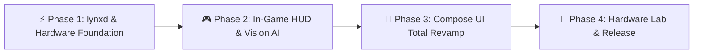

# 🗺️ Lynx V7 - Deity Master Engineering Roadmap
> **Target Release**: Lynx V7 Generation (`7.0.0-RC252+` Uncapped RC Cycle)  
> **Repository**: [Zy0x/Lynx](https://github.com/Zy0x/Lynx) | **Base**: `main` <- **Head**: `roadmap/v7-deity-master-milestones`  
> **Architectures**: Hybrid Qualcomm Snapdragon & MediaTek (Helio / Dimensity) with Generic Linux Fallback  
> ⚠️ **Governance Rule**: All tasks MUST remain unchecked (`- [ ]`). Checking off items (`- [x]`) is strictly reserved for explicit human user command.

---

## 🏗️ Execution Pipeline

---

## ⚡ Phase 1: Native Rust `lynxd` & Hardware Foundation

### 1.1 Universal CPU & EAS Scheduler Engine (`native/lynxd/src/subsystems/cpu.rs`)
- [ ] **Autonomous Scheduler Guardian v2**
  - [ ] Enforce atomic permissions (`0644`/`0444`) on `/dev/stune/top-app/schedtune.boost` and `schedtune.prefer_idle`.
  - [ ] 500ms watchdog loop while screen-on to restore boost values against OEM power HAL overrides.
  - [ ] EAS Tri-Cluster topology awareness (Prime + Gold + Silver / Cortex-X + A7xx + A5xx).
  - [ ] Dynamic core affinity binding for game render threads without starving audio threads.
- [ ] **Dynamic CPUFreq Governor Tuning**
  - [ ] Adaptive `schedutil` rates: `up_rate_limit_us=500` (in-game) and `down_rate_limit_us=4000` (stability).
  - [ ] MediaTek PPM deep control: override `/proc/ppm/policy/userlimit_cpu_core` and `policy_status`.
  - [ ] Autonomous thermal fallback throttle when battery exceeds 46°C.

### 1.2 Universal GPU & Compositor Engine (`native/lynxd/src/subsystems/gpu.rs`)
- [ ] **Qualcomm Adreno Subsystem (KGSL)**
  - [ ] Override devfreq bus clock on `/sys/class/kgsl/kgsl-3d0/devfreq/min_freq` and `max_freq`.
  - [ ] Tune KGSL bus latency nodes (`bus_split`, `force_bus_on`, `force_rail_on`, `force_clk_on`).
  - [ ] Smooth transition governor: `msm-adreno-tz` (balanced) <-> `performance` (gaming).
  - [ ] Shader cache pre-warming via `debug.hwui.use_gpu_pixel_buffers = true`.
- [ ] **MediaTek Mali Subsystem (GED / FPSGO)**
  - [ ] Boost MTK GED via `/proc/ged/hal/custom_upbound_gpu_freq` and `custom_boost_gpu_freq`.
  - [ ] Tune MTK FPSGO: target framerate and boost thresholds in `/sys/module/mtk_fpsgo/parameters/`.
  - [ ] ARM Mali Kbase scheduling priority boost via `/sys/devices/platform/13040000.mali/dvfs_enable`.
- [ ] **Generic Linux Devfreq Driver Fallback**
  - [ ] Automatic fallback to `/sys/class/devfreq/` if vendor nodes are unavailable.
  - [ ] Transaction write verification on all clock applied nodes.

### 1.3 Universal Fast Charging (PumpExpress & Multi-OEM)
- [ ] **Unified Current Control Architecture (`native/lynxd/src/hardware/charging.rs`)**
  - [ ] Auto-detect charging protocols: MediaTek PumpExpress (PE+ 1.0–4.0), Qualcomm QC (3.0–5.0), USB-PD PPS, and OEM proprietary (Transsion, Xiaomi, VOOC).
  - [ ] Universal battery current node hooks:
    - [ ] `/sys/class/power_supply/battery/current_max`
    - [ ] `/sys/class/power_supply/battery/constant_charge_current_max`
    - [ ] `/sys/class/power_supply/main/current_max`
    - [ ] `/sys/class/power_supply/usb/current_max`
    - [ ] `/sys/devices/platform/charger/charging_current`
    - [ ] `/sys/class/power_supply/battery/step_charging_enabled`
  - [ ] Safe Current Presets:
    - [ ] *Standard Safe*: 1500mA – 2000mA (Low temp, battery longevity).
    - [ ] *Turbo Fast*: 2500mA – 3300mA (Optimized daily fast charge).
    - [ ] *Extreme Unrestricted*: Up to 4500mA+ (Full OEM spec, requires external cooling).
- [ ] **Thermal-Aware Step Charging**
  - [ ] 2-second battery temperature polling during active charging.
  - [ ] Dynamic current derating curve:
    - [ ] `< 38°C`: Full preset current.
    - [ ] `38°C – 42°C`: -15% gradual reduction to prevent thermal spikes.
    - [ ] `42°C – 45°C`: Clamp to 1500mA (OEM safety threshold).
    - [ ] `> 45°C`: Emergency throttle to 1000mA until cooled below 40°C.

### 1.4 True Bypass Charging (Direct Motherboard Power)
- [ ] **Battery Charge Suspend Engine**
  - [ ] Target universal hardware bypass nodes:
    - [ ] `/sys/class/power_supply/battery/charging_enabled` -> `0`
    - [ ] `/sys/class/power_supply/battery/battery_charging_enabled` -> `0`
    - [ ] `/sys/class/power_supply/battery/input_suspend` -> `1`
    - [ ] `/sys/class/power_supply/battery/charge_control_limit_max` -> `0`
    - [ ] `/sys/class/power_supply/battery/store_mode` -> `1` (Sony/Samsung/Infinix demo mode)
    - [ ] `/sys/class/power_supply/main/charging_enabled` -> `0`
  - [ ] Hardware verification: Battery current MUST read `0 mA` (or net `±50 mA`) while charger powers system.
- [ ] **Kernel Patch Module (KPM) Fallback**
  - [ ] C-based KPM driver in `native/kpm/lynx_bypass_charge/` for OEM kernels locking sysfs nodes at driver level.
  - [ ] Hook into kernel `power_supply_set_property` and `charger_manager`.
- [ ] **Smart In-Game Auto-Bypass Trigger**
  - [ ] Auto-detect heavy games (Genshin, HSR, WuWa, PUBG, MLBB) foregrounded with charger plugged.
  - [ ] Auto-engage bypass when battery level reaches target threshold (e.g. >= 80%).
  - [ ] Instant charge restoration upon game exit or charger disconnect.

### 1.5 Low-Latency Gaming Wi-Fi & Network Stack
- [ ] **Chipset Wi-Fi Driver Optimization**
  - [ ] Disable Wi-Fi Power Save Mode (PSM) during active gameplay to eliminate jitter spikes.
  - [ ] Tune Qualcomm WCNSS bonding in `platforms/qcom/system/vendor/firmware/wlan/`.
  - [ ] Optimize MediaTek Wi-Fi config (`/vendor/firmware/wifi.cfg` and `/proc/net/wlan/`).
- [ ] **Kernel TCP/IP Stack Tuning**
  - [ ] Enable TCP BBR or Westwood congestion control for minimal wireless packet loss.
  - [ ] Gaming socket buffer scaling:
    - [ ] `net.core.rmem_max = 8388608` (8 MB receive buffer)
    - [ ] `net.core.wmem_max = 8388608` (8 MB transmit buffer)
    - [ ] `net.ipv4.tcp_rmem = 4096 87380 8388608`
    - [ ] `net.ipv4.tcp_wmem = 4096 65536 8388608`
  - [ ] FQ-CoDel packet scheduling to prevent bufferbloat.
  - [ ] Tune ARP cache timeouts and disable TCP slow start after idle.

### 1.6 Virtual Memory & Anti-Allocstall Guard
- [ ] **Advanced ZRAM / ZSWAP Tuning**
  - [ ] High-speed compression via `lz4` or `zstd` with `zsmalloc` allocator.
  - [ ] Dynamic ZRAM disk scaling (50%–75% of physical RAM) with swap priority `32767`.
- [ ] **Anti-Allocstall Guard**
  - [ ] Maintain `extra_free_kbytes = 65536` (64 MB) and `watermark_scale_factor = 150` on performance profiles.
  - [ ] Set `vfs_cache_pressure = 50` to retain open-world inodes in RAM.
  - [ ] Suppress synchronous direct compaction while game render threads are active.

---

## 🎮 Phase 2: In-Game HUD & Vision AI Engine

### 2.1 Sidebar Handle & Touch Ergonomics
- [ ] **Dual-Orientation Coordinate Persistence**
  - [ ] Independent Y-axis handle coordinate storage for Portrait and Landscape in `HudPreferences.kt`.
  - [ ] Instant handle position restoration with zero jumping or snapping upon sidebar close.
  - [ ] Safe-area bounds clamping against punch-hole cameras and system gesture zones.
- [ ] **Handle Visuals & Feedback**
  - [ ] Cyberpunk OLED translucent capsule with subtle cyan accent lines.
  - [ ] Haptic tick on touch, drag, and release.
  - [ ] Idle opacity dial for distraction-free gaming.

### 2.2 Floating Live Telemetry Cards
- [ ] **Real-Time Framerate & Latency Gauge**
  - [ ] SurfaceFlinger pipe parser (<1% CPU overhead) for live FPS calculation.
  - [ ] Real-time frametime sparkline with micro-stutter spike detection.
- [ ] **Hardware Load & Multi-Sensor Monitoring**
  - [ ] Per-cluster CPU load breakdown (LITTLE / MID / BIG) with live MHz indicators.
  - [ ] GPU utilization (%) and active clock frequency.
  - [ ] Real-time SoC die temperature, battery temperature, and live charge/discharge current (mA).

### 2.3 In-Game Quick Action Toggles
- [ ] **1-Tap Profile Switcher**: Rapid toggle between *Balanced*, *Performance*, and *Extreme*.
- [ ] **1-Tap Bypass Charging**: Toggle direct motherboard power without leaving the game.
- [ ] **1-Tap Network Latency Booster**: Flush Wi-Fi packet queues and reset gaming TCP buffers.
- [ ] **1-Tap RAM Purge**: Safe background cache reclamation without killing foreground game process.

### 2.4 Multi-Game Vision AI Auto-Skip Expansion
- [ ] **Triple-Shield Vision AI Refinement**
  - [ ] Multi-pixel glyph check (`maxRun >= 3` contiguous pixels) with 18px dynamic threshold on 1080p.
  - [ ] 80% black margin evaluation on prompt rows to distinguish dialogue bars from dark caves.
- [ ] **RPG Database Expansion**
  - [ ] **Honkai: Star Rail**: Story dialogue and option prompt detection.
  - [ ] **Zenless Zone Zero**: Comic panel dialogues and city NPC chats.
  - [ ] **Wuthering Waves**: NPC dialogues and narrative sequences.
- [ ] **Vision AI Calibration GUI in Companion App**
  - [ ] On-device screenshot preview with bounding box overlays.
  - [ ] Interactive sliders for color tolerance and slice thresholds.

---

## 🎨 Phase 3: Total Compose UI Revamp (`LynxCompanion`)

### 3.1 Design System & Cyberpunk OLED Tokens
- [ ] **OLED Palette & High-Contrast Tokens**
  - [ ] Pure black backgrounds (`#050505` / `#0A0A0A`) for AMOLED power savings.
  - [ ] Layered contrast cards (`#121212` to `#181818`) with crisp 1dp borders (`#262626`).
  - [ ] Semantic accents: Neon Cyan (`#00FFAA`), Electric Blue (`#0099FF`), Amber Gold (`#FFB800`), Crimson Red (`#FF3366`).
- [ ] **Touch Ergonomics & Motion**
  - [ ] Strict 48×48dp minimum touch targets on all interactive elements.
  - [ ] Pixel-stable layouts across non-standard aspect ratios (20:9, 20.5:9, 21:9) and tablets.
  - [ ] 150–250ms Compose micro-animations with zero GC pressure.

### 3.2 Tab 0: System Identity Dashboard
- [ ] **System Identity Hero Card**
  - [ ] Dynamic animated SoC architecture badge: Qualcomm Snapdragon vs MediaTek Helio/Dimensity.
  - [ ] Native `lynxd` daemon telemetry (PID, uptime, RSS memory, AArch64 target).
  - [ ] Universal root status badge (KernelSU / APatch / Magisk).
- [ ] **Live Gauge Bento Tiles**
  - [ ] Circular progress meters for CPU load, GPU clock, and RAM consumption.
  - [ ] Live battery tile: percentage, mV, °C, and bypass active indicator.
- [ ] **Master Profile Carousel**: 1-tap selector for *Powersave*, *Balanced*, *Performance*, *Extreme*.

### 3.3 Tab 1: Unified Hardware Tuning Hub
- [ ] **CPU Tuning Hub (`CpuMasterTunerCard`)**: Per-cluster min/max clock sliders and core lock toggles.
- [ ] **GPU Tuning Hub (`GpuMasterTunerCard` & `AdaptiveGpuHardwareCard`)**: Physical OPP clock picker with Bezier load waveform and isolated sysfs driver controls.
- [ ] **Charging & Battery Hub (`TuningChargingCategory`)**: Universal fast charge slider (1000–4500mA+) and bypass charge toggle with safety dialogs.
- [ ] **Display & Touch Hub (`DisplayRefreshRateTouchCard`)**: SurfaceFlinger HWC mode switcher (60/90/120/144Hz) and TouchBoost tuner.
- [ ] **Network Hub (`NetworkLatencyTunerCard`)**: Gaming Wi-Fi toggle and TCP congestion control picker (BBR / Cubic).

### 3.4 Tab 2: Pure Read-Only Diagnostics
- [ ] **Domain Isolation**: Tab 2 strictly read-only with zero interactive mutation controls.
- [ ] **Deep Hardware Specs**: Kernel DTB nodes, GPU renderer string, Vulkan API, OpenCL extensions.
- [ ] **Thermal Matrix**: CPU clusters, GPU, battery, charger IC, and skin sensors.
- [ ] **Storage I/O Diagnostics**: UFS/eMMC health report, read/write IOPS throughput.

### 3.5 Tab 3: Per-App Graphics Hub & Experimental Lab
- [ ] **Per-App Profile Hub**: Package list with search filter; assign performance mode and refresh rate per game.
- [ ] **Battery Lab (`BatteryLabSubscreen`)**: Power drain simulator, true capacity health tracker, and sparkline charge history.
- [ ] **Cron Automation Manager**: Scheduled cache trimming and daily profile reset.

### 3.6 Settings, OTA Updater & Backup
- [ ] **In-App OTA Updater**: Direct GitHub Releases API integration with in-app changelog viewer and SHA-256 validation.
- [ ] **Backup & Restore**: Export/import `lynx_config.json` and 2-step factory reset failsafe.

---

## 🧪 Phase 4: Hardware Lab, Failsafes & Production Release

### 4.1 Physical Hardware Test Matrix
- [ ] **MediaTek Validation (Infinix Note 11 Pro / X698 — Helio G96, Mali-G57 MC2, 2460×1080)**
  - [ ] Anti-spoofing detection via kernel DTB and GPU nodes (`/dev/mali0`, `/dev/ged`).
  - [ ] MediaTek PumpExpress fast charging and Transsion charger bypass verification.
  - [ ] Genshin Impact 60 FPS thermal and frametime stability on Performance & Extreme.
- [ ] **Qualcomm Validation (Xiaomi Redmi Note 7 — SDM660, Adreno 512, 2340×1080)**
  - [ ] Passive read-only verification of Adreno nodes (`/dev/kgsl-3d0`, devfreq bus).
  - [ ] Quick Charge and USB-PD step charging inspection.
- [ ] **Generic Linux Fallback**: Graceful functionality without crashes on generic devices.

### 4.2 Thermal & Endurance Trials
- [ ] **60-Minute Gaming Stress Test**: Sustained CPU/GPU clock without premature throttling; thermal clamp at 42°C.
- [ ] **3-Hour Bypass Endurance Trial**: 0% battery delta over 3 hours of continuous gaming on charger; verify 4°C–6°C cooler battery temps.

### 4.3 Safety Failsafes & Bootloop Mitigation
- [ ] **Emergency Hardware Disarm**: Pressing `Volume Down` on boot disables module and resets to *Safe Balanced*.
- [ ] **Dormant First-Boot Protocol**: Module installs with `"active_profile": "dormant"`, forbidding aggressive clocks until user activation.
- [ ] **Uninstall Rollback (`uninstall.sh`)**: 100% restoration of OEM kernel parameters and Android settings.

### 4.4 Packaging & Release Pipeline
- [ ] **Code Hygiene**: All Kotlin files strictly under 699 lines; Rust `lynxd` binary stripped with LTO.
- [ ] **Dual-Artifact Pipeline**: Release APK (`LynxKernelManager.apk`) with R8 minification + Universal Magisk/KSU/APatch ZIP module.
- [ ] **Release Metadata**: Synchronize version tags across `module.prop`, `changelog.md`, and Companion app Gradle script.

---

## 📊 Milestone Tracking Matrix

| Phase | Focus Domain | Sub-Tasks | Status |
| :--- | :--- | :---: | :---: |
| **Phase 1** | Native Rust `lynxd`, Fast Charging, Bypass & Wi-Fi | 32 Sub-Tasks | 🟡 *Ready for Execution* |
| **Phase 2** | In-Game HUD, Telemetry & Multi-Game Vision AI | 22 Sub-Tasks | 🟡 *Ready for Execution* |
| **Phase 3** | Total Compose UI Revamp (Tabs 0–3 & Settings) | 36 Sub-Tasks | 🟡 *Ready for Execution* |
| **Phase 4** | Physical Lab Validation, Failsafes & Production Release | 18 Sub-Tasks | 🟡 *Ready for Execution* |
| **TOTAL** | **Lynx V7 - Deity Master Engineering Roadmap** | **108 Sub-Tasks** | 🟡 **0 / 108 (0%)** |

---
*Maintained under Lynx strict engineering governance. Checking tasks is reserved exclusively for explicit user instructions.*
