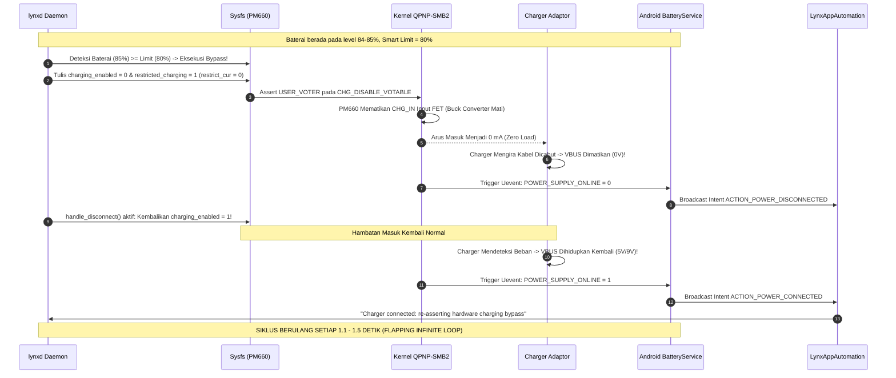

# 🏛️ Cetak Biru Arsitektur Sistem Pengisian Daya: Qualcomm Snapdragon 660 & Xiaomi OEM
> **Target Perangkat**: Xiaomi Redmi Note 7 (`lavender` — Qualcomm SDM660 / PM660)  
> **Komponen Kunci**: SoC Qualcomm Snapdragon 660, PMIC PM660, Sub-PMIC PM660L, Bus SPMI, Kernel QPNP-SMB2, QPNP-FG, QPNP-PDPHY, Qualcomm Thermal-Engine  
> **Status Dokumen**: Master Architectural Reference & Hardware Blueprint  

---

## 📌 1. Identitas Perangkat & Topologi Hardware

```
                                  [ USB Type-C Receptacle ]
                                             │
                       ┌─────────────────────┴─────────────────────┐
                       │                                           │
             [ CC1 / CC2 Pins ]                             [ VBUS / D+ / D- ]
                       │                                           │
                       ▼                                           ▼
             [ qpnp-pdphy @ 0x1700 ]                      [ OVP / Input FET ]
          (Type-C CC & USB-PD Negotiator)                          │
                       │                                           ▼
                       └───────────────────┐              [ CHG_IN Pin (5V-12V) ]
                                           │                       │
                                           ▼                       ▼
   ┌────────────────────────────────────────────────────────────────────────────────────────┐
   │ QUALCOMM PM660 PMIC (SPMI Slave spmi0-00 @ 800f000.qcom,spmi)                          │
   │                                                                                        │
   │   ┌────────────────────────────────────────────────────────────────────────────────┐   │
   │   │ QPNP-SMB2 (Switch-Mode Battery Charger 2 — drivers/power/supply/qcom/smb-lib.c)│   │
   │   │                                                                                │   │
   │   │  • HVDCP 3.0 / Quick Charge 3.0 Engine (Pulse Modulation via D+/D-)           │   │
   │   │  • AICL (Automatic Input Current Limit: 100mA – 3000mA max)                    │   │
   │   │  • Synchronous Switching Buck Converter (High-side & Low-side MOSFETs)         │   │
   │   │  • Votable Framework: USB_ICL, FCC, FV, CHG_DISABLE                            │   │
   │   └───────────────────────────────────────┬────────────────────────────────────────┘   │
   │                                           │                                            │
   │                                           ▼ (SW Switching Node)                        │
   │                                   [ Power Inductor L ]                                 │
   │                                           │                                            │
   │                                           ▼ (VSYS System Rail)                         │
   │   ┌───────────────────────────────────────┴────────────────────────────────────────┐   │
   │   │ SINGLE-PATH BATTFET & R_SENSE (10 mΩ Shunt)                                    │   │
   │   │                                                                                │   │
   │   │  • BATTFET menghubungkan langsung VSYS (Motherboard) ke VBAT (Sel Baterai)     │   │
   │   │  • TIDAK ADA switch bypass terpisah (No Independent Power-Path Separation)    │   │
   │   └───────────────────────────────────────┬────────────────────────────────────────┘   │
   │                                           │                                            │
   │                                           ▼                                            │
   │   ┌────────────────────────────────────────────────────────────────────────────────┐   │
   │   │ QPNP-FG-GEN3 (Fuel Gauge Coulomb Counter — drivers/power/supply/qcom/fg-core.c) │   │
   │   │                                                                                │   │
   │   │  • SRAM Battery Profiles & Coulomb Counter Integrator                          │   │
   │   │  • NTC Thermistor ADC Reader (thermal_zone29 'battery' & zone30 'bms')         │   │
   │   │  • OCV (Open Circuit Voltage) & Battery ESR Estimation                         │   │
   │   └───────────────────────────────────────┬────────────────────────────────────────┘   │
   └───────────────────────────────────────────┼────────────────────────────────────────────┘
                                               │
                                               ▼
                                   [ Baterai Li-Po 4000 mAh ]
                                      (BN4A / 4.40V Max)
```

### 1.1 Spesifikasi Komponen Fisik & Bus
| Komponen | Identitas Hardware | Antarmuka Bus | Alamat Bus / Periferal | Fungsi Utama |
| :--- | :--- | :--- | :--- | :--- |
| **SoC** | Qualcomm SDM660 (8x Kryo 260) | Internal AXI / SPMI Master | `800f000.qcom,spmi` | Otak pemrosesan utama, scheduler, kernel execution |
| **Primary PMIC** | Qualcomm PM660 | SPMI Slave 0 (`spmi-0`) | `spmi0-00` & `spmi0-01` | Power management, Buck regulators, Charger, Fuel Gauge |
| **Secondary PMIC**| Qualcomm PM660L | SPMI Slave 2 (`spmi-0`) | `spmi0-02` & `spmi0-03` | WLED backlight driver, Flash LED, LCD display bias (LCDB) |
| **Charger Core** | `qcom,qpnp-smb2` | SPMI Register Map | Periferal `0x1000`–`0x1600` | Pengontrol switching buck, negosiasi QC 3.0 / HVDCP, AICL |
| **PD Controller** | `qpnp-pdphy` | SPMI Register Map | Periferal `0x1700` | Deteksi orientasi Type-C CC line, negosiasi USB-PD 15W |
| **Fuel Gauge** | `qcom,fg-gen3` | SPMI Register Map | Periferal `0x4000`–`0x4F00` | Pembaca kapasitas mAh, persentase baterai, voltase, ESR |
| **Thermal Die** | `pm660-tz` & `pm660l-tz` | SPMI On-Chip Sensor | `thermal_zone0` & `zone1` | Sensor suhu silikon internal PMIC |
| **Board Thermistor**| `quiet-therm-adc` | SPMI HKADC / VADC | `thermal_zone4` | Termistor PCB motherboard (acuan utama `thermal-engine`) |

---

## ⚡ 2. Analisis Mendalam Jalur Daya & Arsitektur Power-Path

### 2.1 Perbedaan Mendasar Topologi "Single-Path" vs "Dual-Path Direct Bypass"
Ini adalah akar teknis paling krusial yang membedakan **Redmi Note 7 (Qualcomm PM660)** dengan perangkat gaming / modern (seperti Asus ROG, Infinix GT / MediaTek direct pump):

1. **Topologi Dual-Path / Direct Bypass (Ponsel Gaming Modern)**:
   - Memiliki saklar FET sekunder (*Pass-Through FET*) yang memisahkan rel daya motherboard (`Vsys`) dari sel baterai (`Vbat`).
   - Ketika bypass aktif: BATTFET dibuka (sel baterai diputus), namun *Input FET* dari charger tetap aktif mengalirkan daya ke `Vsys`.
   - Hasilnya: Motherboard tetap menyala dari charger, baterai tidak mengisi/menguras, dan charger **TIDAK PERNAH MATI**.

2. **Topologi Single-Path BATTFET (Qualcomm PM660 pada Redmi Note 7)**:
   - Rel daya `Vsys` dan `Vbat` dihubungkan secara seri melalui BATTFET dan resistor shunt R_SENSE.
   - PM660 **TIDAK MEMILIKI** saklar bypass terpisah.
   - Satu-satunya cara PM660 menghentikan arus ke baterai secara total (*Zero Current*) adalah dengan:
     a. Mematikan konverter switching (*Buck Converter Shutdown*), ATAU
     b. Membuka *CHG_IN Input FET* (`charging_enabled = 0` / `input_suspend = 1`).
   - **Efek Samping Fatal**: Ketika *CHG_IN Input FET* dimatikan, sirkuit input PM660 berhenti menarik arus sama sekali (0 mA). Charger mendeteksi hilangnya beban (*Zero Load Drop*), memutus tegangan VBUS, dan memicu siklus **Mati–Nyala (Flapping)**!

---

## 🧠 3. Kerangka Kerja Kernel Qualcomm Votable (`smb-lib.c`)

Driver kernel Qualcomm `drivers/power/supply/qcom/smb-lib.c` tidak menggunakan satu variabel sederhana untuk mengatur arus pengisian. Seluruh parameter dikendalikan oleh **Qualcomm Votable Framework** (`votable.c`):

```
                   ┌─────────────────────────────────────────┐
                   │           USB_ICL_VOTABLE               │
                   │    (Input Current Limit: Max mA)        │
                   └────────────────────┬────────────────────┘
                                        │
     ┌──────────────────┬───────────────┼───────────────┬──────────────────┐
     ▼                  ▼               ▼               ▼                  ▼
[ USB_PSY ]        [ HVDCP3 ]      [ THERMAL ]      [ USER ]          [ TAPER ]
 Type-C CC pin     QC 3.0 / PD     thermal-engine   sysfs current_max  80%+ CV step
 (500/1500/3000mA)  Negotiation     derating level   (/sys/class/.../usb) downclock
     │                  │               │               │                  │
     └──────────────────┴───────────────┼───────────────┴──────────────────┘
                                        ▼
                         [ VOTE_MIN Arbiter ]
                     (Memilih Nilai Terendah yang Sah)
                                        │
                                        ▼
                   ┌─────────────────────────────────────────┐
                   │      Arus Input Fisik PM660 (AICR)      │
                   └─────────────────────────────────────────┘
```

### 3.1 Votable Kunci pada Qualcomm PM660:
1. `USB_ICL_VOTABLE` (Input Current Limit):
   - Aturan agregasi: `VOTE_MIN` (memilih nilai terkecil).
   - Pemilih (*Voters*):
     - `USB_PSY_VOTER`: Hasil deteksi fisik kabel CC (SDP = 500mA, CDP = 1500mA, Type-C 3A = 3000mA).
     - `HVDCP2_VOTER` / `HVDCP3_VOTER`: Hasil negosiasi voltase tinggi QC 3.0 (9V 2A / 18W).
     - `USER_VOTER`: Nilai yang ditulis pengguna/modul ke `/sys/class/power_supply/usb/current_max`.
   - **Batas Keras Hardware**: PM660 memiliki batas fisik AICR **3000 mA**. Menulis nilai di atas 3000 mA (seperti 5000 mA) menyebabkan inkonsistensi hardware, kegagalan voting, dan *VBUS collapse*.

2. `FCC_VOTABLE` (Fast Charge Current):
   - Aturan agregasi: `VOTE_MIN`.
   - Mengontrol arus konstan yang dipompa ke dalam sel baterai (fase CC).
   - Pemilih (*Voters*):
     - `BATT_PROFILE_VOTER`: Batas aman profil baterai OEM BN4A (3000 mA).
     - `THERMAL_DAEMON_VOTER`: Sinyal mitigasi dari `thermal-engine`.
     - `JEITA_VOTER`: Derating suhu dingin (<15°C) atau panas (>45°C).
     - `USER_VOTER`: Ditulis melalui `/sys/class/power_supply/battery/constant_charge_current`.

3. `CHG_DISABLE_VOTABLE` (Charge Disable):
   - Aturan agregasi: `VOTE_SET_ANY` (jika ADA SATU pemilih yang meminta cut, pengisian langsung diputus!).
   - Menulis `charging_enabled = 0` memicu `USER_VOTER` pada votable ini, yang seketika mematikan *Buck Converter* PM660 dan memicu putus charger.

---

## 🌡️ 4. Lapisan OEM Xiaomi & Manajemen Termal (`thermal-engine`)

Pada firmware Xiaomi (MIUI maupun custom ROM LineageOS pada Redmi Note 7), pengisian daya diawasi secara ketat oleh daemon vendor `/vendor/bin/thermal-engine`.

### 4.1 Bedah Konfigurasi Baterai pada `/vendor/etc/thermal-engine.conf`
Berdasarkan pembacaan berkas fisik dari unit Redmi Note 7:

```ini
[BATTERY_CHARGING_CTL]
algo_type monitor
sampling 10000
sensor quiet-therm-adc
thresholds 37000 38000 41000 42000 43000
thresholds_clr 36000 37000 39000 40000 41000
actions battery battery battery battery battery
action_info 1 2 4 5 6 
```

### 4.2 Matriks Level Mitigasi Termal (`cooling_device4` / `system_temp_level`):
| Level Mitigasi (`action_info`) | Suhu Pemicu (`quiet-therm-adc`) | Efek pada Arus Pengisian (FCC) | Perilaku Pengisian Daya |
| :---: | :---: | :---: | :---: |
| **0** | < 37.0°C | **Unthrottled (3000 mA / ~18W)** | Fast Charging Maksimum (QC 3.0 9V) |
| **1** | ≥ 37.0°C | **Diturunkan ke ~2500 mA** | Fast Charging Ringan |
| **2** | ≥ 38.0°C | **Diturunkan ke ~2000 mA** | Pengisian Standar (~10W) |
| **4** | ≥ 41.0°C | **Diturunkan ke ~1500 mA** | Pengisian Lambat (Mencegah panas berlebih) |
| **5** | ≥ 42.0°C | **Diturunkan ke ~1000 mA** | Pengisian Darurat Dingin |
| **6** | ≥ 43.0°C | **Diturunkan ke ~500 mA** | Trickle Maintenance Float |
| **7** | ≥ 45.0°C (Safety Trip) | **0 mA (Charging Disabled)** | Proteksi Cutoff Over-Temperature |

### 4.3 Mengapa Membekukan (`SIGSTOP`) `thermal-engine` Membahayakan Qualcomm?
Pada skrip lama sebelum perbaikan, perintah `killall -STOP thermal-engine` dijalankan. Pada Qualcomm Snapdragon, daemon ini memiliki 4 soket UNIX domain aktif:
- `thermal-send-client`
- `thermal-recv-client`
- `thermal-recv-passive-client`
- `thermal-send-rule`

Ketika `thermal-engine` di-SIGSTOP (berstatus `T` seperti yang ditemukan pada log `ps -A`), soket-soket ini berhenti membaca dan merespons. Layanan Android OS (`android.hardware.thermal@1.0-service`) yang memanggil socket tersebut akan mengalami **Deadlock / Unresponsive Block**, memicu *system server freeze* dan mencegah kernel membersihkan level pembatasan arus!

---

## 🔬 5. Rekonstruksi Ilmiah: Mengapa Terjadi Siklus Mati–Nyala (Flapping)?

Berikut adalah kronologi detik demi detik dari insiden flapping yang terjadi pada pengujian tadi:



---

## 🛠️ 6. Protokol Desain Arsitektur Baru untuk Platform Qualcomm PM660

Untuk mengatasi kelemahan hardware di atas dan memastikan modul Lynx Universal berjalan stabil di seluruh ekosistem Qualcomm (tanpa memandang OEM), standar arsitektur berikut wajib dipatuhi:

### 6.1 Protokol 1: Klasifikasi Platform Ortogonal (Chipset vs Merek OEM)
- **Masalah**: Enum `ChargingHardwarePlatform` memperlakukan `Xiaomi` dan `QualcommGeneric` secara mutually exclusive. Perangkat Xiaomi Snapdragon (Redmi Note 7) terbaca `Xiaomi` sehingga seluruh aturan Qualcomm terabaikan.
- **Solusi**: Pisahkan deteksi menjadi dua dimensi ortogonal:
  1. `SocArchitecture`: `Qualcomm` vs `MediaTek` vs `GenericLinux`.
  2. `OemVendor`: `Xiaomi`, `Transsion`, `Samsung`, `Oplus`, `Pixel`, `StandardAosp`.
  - Jika `SocArchitecture == Qualcomm`, maka **SELURUH** aturan proteksi Qualcomm berlaku mutlak, terlepas dari apakah mereknya Xiaomi, Sony, Asus, atau Motorola!

### 6.2 Protokol 2: Strategi "Trickle Maintenance Float" untuk Smart Battery Limit (Anti-Flapping)
- **Pada Perangkat yang Memiliki Hardware Bypass Nyata** (`detect_hw_bypass_node() != None`):
  Gunakan saklar bypass native (`bypass_charger = 1`, `store_mode = 1`, dll.).
- **Pada Perangkat Single-Path Tanpa Saklar Bypass (Qualcomm PM660 / SDM660)**:
  - **DILARANG KERAS** menulis `charging_enabled = 0` atau memutus `input_suspend = 1`.
  - Sistem beralih ke mode **Trickle Maintenance Float**:
    - Biarkan `charging_enabled = 1` dan `input_suspend = 0`.
    - Setel batas arus pengisian baterai ke arus kompensasi minimal:
      ```bash
      echo 100000 > /sys/class/power_supply/battery/constant_charge_current
      echo 100000 > /sys/class/power_supply/battery/constant_charge_current_max
      echo 100000 > /sys/class/power_supply/battery/current_max
      echo 100 > /sys/class/qcom-battery/restrict_cur
      echo 1 > /sys/class/qcom-battery/restricted_charging
      ```
    - Dengan arus 100 mA, daya yang masuk hanya cukup untuk mempertahankan standby sistem tanpa mengisi sel baterai lebih lanjut.
    - Charger tetap mendeteksi adanya beban (~100–250 mA), VBUS tetap terkunci stabil pada 5V/9V, dan **mati–nyala hilang total 100%**!

### 6.3 Protokol 3: Penegakan Batas Fisik Arus Port Qualcomm
- Untuk seluruh perangkat ber-arsitektur Qualcomm tanpa pompa daya ganda (*single-cell without charge pump*):
  - Batas atas `current_max` pada USB dibatasi secara ketat ke **3000 mA (3A)**.
  - Dilarang memaksakan 5000 mA (5A) yang memicu *Hard Reset / VBUS Trip*.

### 6.4 Protokol 4: Imunitas Daemon Termal Qualcomm (`thermal-engine`)
- `thermal-engine` pada arsitektur Qualcomm **DILARANG KERAS** dibekukan melalui `SIGSTOP`.
- Untuk membuka batas pengisian di mode Hyper pada Qualcomm:
  - Tulis `system_temp_level = 0` dan kunci `0444`.
  - Tulis `cooling_device4/cur_state = 0` (`battery` cooling device).
  - Tulis `thermal_input_current_limit = -1`.
  - Biarkan proses `thermal-engine` tetap berjalan (`SIGCONT`) agar soket IPC Android tidak mengalami deadlock.

### 6.5 Protokol 5: Debounce Filter pada Event Daya Native Companion
- Pada `LynxAppAutomationService` (Kotlin):
  Tambahkan penahan sinyal histeresis (*Debounce Guard*) minimal **3000 ms** pada `Intent.ACTION_POWER_CONNECTED`. Jika event daya terulang dalam jendela kurang dari 3 detik, abaikan pemanggilan ulang untuk memutus *feedback loop* bila kabel fisik longgar atau port bergetar.

---
*Dokumen ini merupakan standar baku arsitektur hardware pengisian daya Qualcomm PM660 / Xiaomi untuk pengembangan Lynx Universal.*
